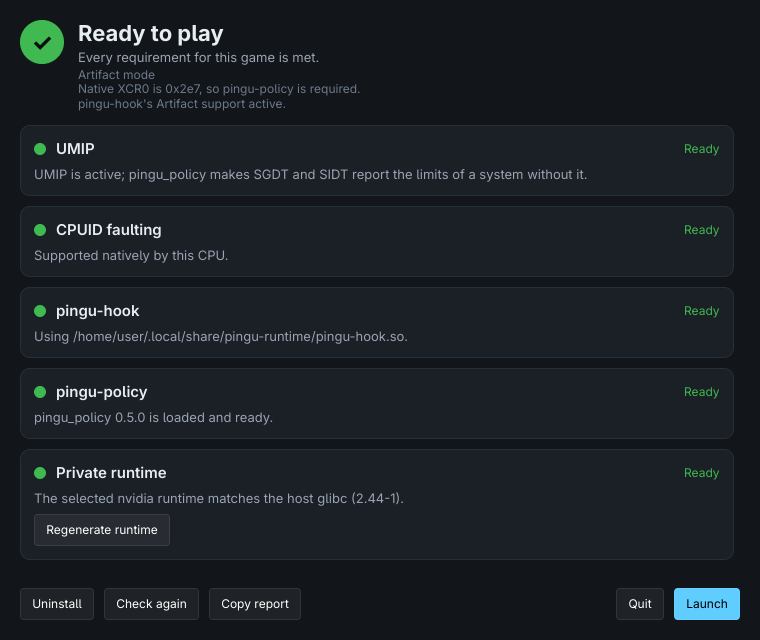

# Pingu Launcher

Run games that need AVX2 on Linux machines whose CPU, or whose AVX-512 optimized
host libraries, get in their way. `pingu-launcher` runs a selected Proton/Wine process
tree with **real XCR0 exactly `0x7`**, while unrelated host processes retain AVX-512. It
checks the machine, sets up everything the game needs and starts it. The preload
library, the wrapper, the runtime builder and the kernel module sources are all inside
the one file, so a release is a single binary.



This repository does not modify game executables or distribute game files.

## Quick Start

### 1. Download the launcher

Get `pingu-launcher-<version>-x86_64` and its `.sha256` file from the
[latest release](https://github.com/MagicalBroccoli/Pingu-Launcher/releases/latest),
then check it and put it somewhere permanent:

```sh
sha256sum -c pingu-launcher-*-x86_64.sha256
install -Dm755 pingu-launcher-*-x86_64 ~/.local/bin/pingu-launcher
```

It runs on glibc 2.31 or newer and needs the `fontconfig` library and a graphical
session (Wayland or X11). Everything else is embedded in the binary.

### 2. Run it

```sh
pingu-launcher
```

or start it from your application menu. Without a game command it opens the window
shown above and checks your machine.

### 3. Follow the instructions

Each card shows one requirement and what is missing. The window can do most of the work
itself:

- **Install DKMS module** builds, tests and loads the `pingu-policy` kernel module
  (it needs `dkms` and `pkexec` and asks for your password once). On SteamOS the button
  reads **Install prebuilt module**. On ostree images such as Bazzite it reads **Build and
  install module**: it builds the module on the machine, which needs the kernel headers, `gcc`
  and `make` layered with `rpm-ostree` first ([docs/cli.md](docs/cli.md)). The same module handles UMIP and, on AMD CPUs that
  cannot fault CPUID, the CPUID faulting emulation.
- **Generate runtime** builds the private library runtime on hosts whose packages contain
  AVX-512 code.
- A **Deprecated setup** card appears when the previous setup is still there (the
  `cpuid_fault_emulation` module, `clearcpuid=umip`, `fred=off`, `ibt=off`) and lists
  the steps to migrate. Kernel command line changes and reboots are shown as steps to do
  by hand.

Press **Check again** after each step. When the headline reads **Ready to play**, the
machine is set up. **Copy report** puts the check results on the clipboard for bug
reports.

### 4. Set it as the command prefix

Select the original Proton for the game, and leave Steam's Linux Runtime or umu enabled.

**Lutris:** open the game's **Configure > System options** and set **Command prefix** to the
full path of `pingu-launcher` (for example `/home/you/.local/bin/pingu-launcher`). Do not
append `%command%` in Lutris.

**Steam:** use the native Steam client (not Flatpak). Select the original Proton in the
game's **Properties > Compatibility** and put this in **Launch Options**, on one line:

```text
/path/to/pingu-launcher %command%
```

**Heroic:** open the game's **Settings > Advanced**, add a **Wrapper command** and enter the
full path to `pingu-launcher` as the executable, with no arguments. Use the full path:
Heroic started from the application menu does not have `~/.local/bin` in its `PATH`. Under
**Wine**, select the original Proton and keep **umu** enabled (do not tick the option that
disables it). Heroic's per-game settings override its global ones, so set the wrapper on each
game.

**Faugus Launcher:** use the native package, not the Flatpak. Open the game's **Edit** dialog,
switch to the **Settings** tab and choose **Launch Arguments** in the **Tools** dropdown. Double-click
the empty row, enter the full path to `pingu-launcher` and press Enter. Faugus puts it directly in
front of `umu-run`, so do not append `%command%`. Settings such as `AVX2_GPU=nvidia` go on their
own rows above it. **MangoHud** and **GameMode** can stay ticked: the launcher keeps whatever
stands in front of `umu-run` (`mangohud`, `gamemoderun`) there inside its namespace. Under **Specific Proton**
select the original Proton (GE-Proton, proton-cachyos or a custom directory, not the `umu-*`
runtimes or Steam), and keep the umu runtime enabled. This setup is not yet in the tested list.

Launch the game as usual. Use a new test prefix when changing setups, and back up your
existing prefix and saves first: this project does not delete, reset or migrate prefixes.

## Tested Setups

These combinations were tested with the launcher.

**Proton**

- GE-Proton
- proton-cachyos-slr
- Valve's Proton

**Launchers**

- Heroic
- Lutris
- Steam
- Faugus

**Hardware**

| Setup | Status |
|---|---|
| Zen 4/5, optimized packages, NVIDIA | Works |
| Zen 4/5, optimized packages, AMD | Works |
| Zen 4/5, not optimized | Works |
| Intel 12th Gen | Works |
| Intel 14th Gen | Works |
| Steam Machine (SteamOS) | Works |

"Optimized" means the host's packages are built for x86-64-v4 or znver4 (for example
CachyOS), which is when the private runtime is needed.

**Games**

| Game | Status |
|---|---|
| Phantom Blade Zero | Works |
| Star Wars Galactic Racer | Works |
| Planet Zoo 2 | Works |
| Crimson Desert | Works |
| Anno 117: Pax Romana | Works |
| F1 2025 | Works |
| Final Fantasy Resonance | Works |
| Football Manager 27 | **Does not work** |

## Requirements

- x86-64 Linux with glibc 2.31 or newer, and a graphical session for the window.
- Native Steam, Lutris, Heroic or Faugus with umu. Flatpak launchers are not supported. An installed
  Proton that requires Steam Linux Runtime, with that runtime already downloaded.
- Bubblewrap with `--ro-overlay` support.
- For the kernel module: matching kernel headers, the installed kernel image, the
  compiler that built the kernel and DKMS. QEMU with KVM is optional but strongly
  recommended: it runs the VM test, and without it the module is built untested.
  Package names for other distributions are in [pingu-policy/README.md](pingu-policy/README.md).
- No kernel command line change is needed: `pingu_policy` reports the limits of a system
  without UMIP itself, emulates CPUID faulting on AMD CPUs without it (a CPU that cannot
  be emulated needs one with native support), hooks the FRED entry points and switches
  kernel IBT off while it is loaded. `clearcpuid=umip`, `fred=off`, `ibt=off` and the old
  `cpuid_fault_emulation` module are deprecated; see
  [docs/cli.md](docs/cli.md#migrating-from-cpuid_fault_emulation-and-clearcpuidumip).
- The private runtime is only needed on hosts whose packages contain AVX-512 code
  (x86-64-v4 or znver4 repositories, such as CachyOS). Building it needs Arch
  Linux/CachyOS with `pacman`, `curl`, `gnupg`, `libarchive` and `archlinux-keyring`.
  Other hosts skip it automatically.

The kernel module passes the VM suite on CachyOS `7.3.3` and on Arch, Debian, Ubuntu,
Fedora and openSUSE kernels from 6.6 to 7.3 (list and limits in
[docs/kernel-module.md](docs/kernel-module.md)). See [docs/runtime.md](docs/runtime.md)
for the runtime.

## How It Works

The kernel module switches XCR0 at kernel/user boundaries for an opted-in process
tree and leaves CPUID to `pingu-hook`. The launcher wraps the game command in a
companion Proton whose entry point is a small static launcher that arms the policy
immediately before Proton starts inside Steam Linux Runtime. A read-only library
overlay supplies generic Arch libraries instead of AVX-512-required host libraries.

```text
Lutris/Steam -> pingu-launcher -> bubblewrap (generic library overlay)
            -> Steam Linux Runtime -> static policy launcher -> Proton -> game
```

| Part | What it is |
|---|---|
| `pingu-launcher` | Window and command line: checks, setup help, the Lutris/Steam wrapper and the runtime builder |
| `pingu-hook` | `LD_PRELOAD` library for CPU profile, system data, clocks and signals ([pingu-hook/](pingu-hook/README.md)) |
| `pingu-policy` | Experimental DKMS kernel module: XCR0 for an opted-in process tree, real `SGDT`/`SIDT` limits under UMIP and CPUID faulting emulation on AMD CPUs without it |
| Private runtime | Generic Arch libraries that replace AVX-512-required host libraries (Arch/CachyOS only) |

The module is built against the installed kernel, not by rebuilding Linux. DKMS
checks kernel symbols and instructions, compiles generated trampolines, then boots that
kernel and module in a disposable VM. A failing test blocks the installation. Without
QEMU or KVM the VM test is skipped with a warning (in the DKMS build log and in the
launcher) and only the static checks run, which is riskier. Future compatible kernel
updates follow this automatically.

**Experimental:** direct kernel code patching can crash a machine. Keep a recovery
kernel, save work before the first load, and never force-unload this module. It remains
pinned until reboot. Missing or changed hook contracts and failed VM tests fail closed;
arbitrary future kernel compatibility is not guaranteed.

## Update And Uninstall

Download a newer release and replace the binary. The window offers **Upgrade runtime**
when a newer package list is available, and DKMS rebuilds the module for new kernels.

The **Uninstall** button at the bottom left of the window removes the installed modules
and their loading at boot (it asks to confirm and for your password). The data directory
`~/.local/share/pingu-runtime` and the launcher itself stay; delete them by hand. To
stop using the launcher for a game, remove the command prefix or launch option.

## More Documentation

- [Command line usage](docs/cli.md): checks, runtime and module tools, manual module
  installation, environment variables and recovery.
- [Kernel module](docs/kernel-module.md) and [runtime](docs/runtime.md) notes.
- [pingu-hook](pingu-hook/README.md).

## Building From Source

You need Rust 1.98 or newer with the musl target (`rustup target add
x86_64-unknown-linux-musl`), a C toolchain, `clang` with `lld`, `curl`, and the
`fontconfig` and `freetype` headers. `make` builds the static helpers and the module
fixtures first (it downloads and checks musl for them):

```sh
git clone https://github.com/MagicalBroccoli/Pingu-Launcher.git
cd Pingu-Launcher
make launcher            # build/pingu-launcher
make launcher-dist       # like a release: Debian 11 container (podman), SteamOS modules embedded, no local paths in the binary
```

## Repository Layout And Tests

- `launcher/`: `pingu-launcher`. `cargo test` needs the module fixtures
  (`make module-validation-assets`); `make launcher-check` does both.
  `make launcher-screenshot` renders the window without a display and updates
  `docs/images/launcher.png`.
- `pingu-hook/`: the preload library, built by the launcher's build script.
- `pingu-policy/`: DKMS source of the module (XCR0 policy, UMIP fixup, CPUID faulting
  emulation) and its validation fixtures.
- `module-tool/`: the static helper that plans the kernel patches and runs the VM test
  (`make module-profile-check` tests it).
- `tools/`, `tests/`: static helper programs and the module's regression tests
  (`make test` runs everything).
- `runtime/`: exact package locks for NVIDIA, AMD and Intel.
- `dist/`: the container image for `make launcher-dist`, which also builds and embeds the
  SteamOS modules (`make steamos-modules`, loader files in `steamos/`).
- `.work/` and `build/`: generated local state, ignored by Git.

## Contributing And Releases

Commit messages follow [Conventional Commits](https://www.conventionalcommits.org),
checked with [commitizen](https://commitizen-tools.github.io/commitizen/) (`.cz.toml`):
`type(scope): subject`, with types such as `feat`, `fix`, `docs`, `refactor`, `build`,
`ci` and `chore`. CI checks the commits of every pull request.

```sh
pipx install commitizen
cz commit                                                # guided commit message
pre-commit install --hook-type commit-msg                # optional: check every commit locally
```

To release, run `cz bump`, which picks the next version from the commits, updates
`launcher/Cargo.toml` and its lock file, commits and creates the `v<version>` tag. Push the
commit and the tag: the release workflow builds the binary and publishes it with a checksum
and a changelog generated from the commits since the previous tag.

## Attributions

This project builds on the work of others:

- **LinUwUx Rust runtime** by [brcly](https://github.com/brcly/linuwux-runtime) (version
  26.9.16, AGPL-3.0): `pingu-hook` is derived from it, with renamed packages, variables and
  protocol variants. The original license text is kept in [pingu-hook/LICENSE](pingu-hook/LICENSE).
- **[Slint](https://slint.dev)**: the launcher window.
- **[Capstone](https://www.capstone-engine.org)**, liblzma, zstd, bzip2 and
  [musl libc](https://musl.libc.org): the static module helper.
- **[Arch Linux](https://archlinux.org) packages**: the private runtime is built on your
  machine from their signed packages and is not redistributed here.
- **Proton and Wine** by Valve, CodeWeavers and the Wine project, **GE-Proton** by
  GloriousEggroll, **proton-cachyos** by [CachyOS](https://cachyos.org), **umu-launcher**,
  **Steam Linux Runtime** and **bubblewrap**: the stack the launcher wraps. None of them are
  bundled.
- **[Lutris](https://lutris.net)**, **[Heroic Games Launcher](https://heroicgameslauncher.com)**,
  **[Faugus Launcher](https://github.com/Faugus/faugus-launcher)** and **Steam**: the launchers
  it works with.
- The **Linux kernel** and **DKMS**: the modules are built against your kernel through them.

All trademarks belong to their owners. Games are named only to report what was tested.

## License

Copyright (C) 2026 Magical Broccoli

This project is licensed under the [GNU Affero General Public License v3.0](LICENSE).
That covers the launcher, the module helper, `pingu-hook` (which inherits it from LinUwUx) and
the kernel module sources, unless a file says otherwise. Components you install separately
keep their own licenses.
